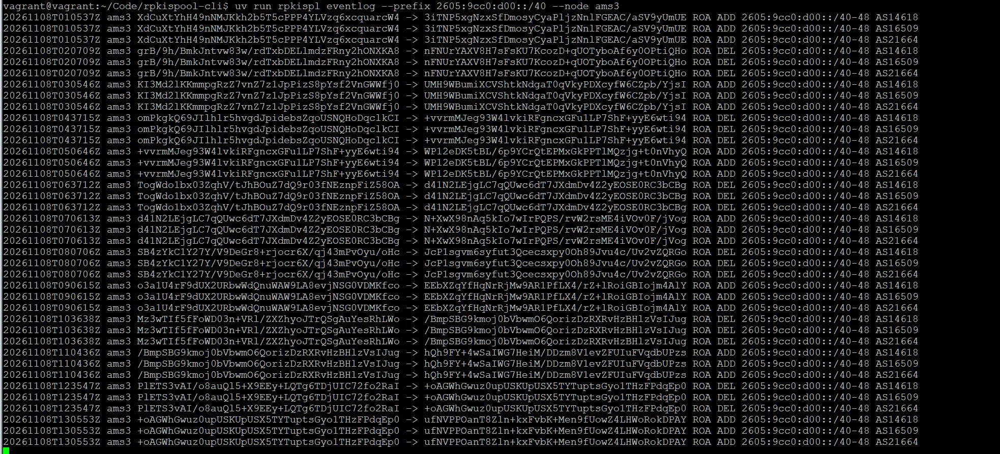
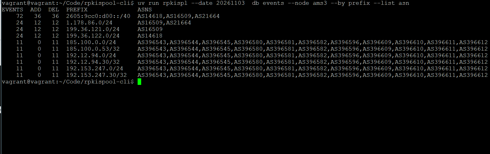

# rpkispool-cli

**rpkispool-cli** is a command-line utility to work with RPKISpool materialization files.

The goal of this project is to provide easy and convenient interface to work with RPKISpool materialization files as defined in [draft-snijders-rpkispool-format](https://datatracker.ietf.org/doc/draft-snijders-rpkispool-format/).

## Core Philosophy

- We prefer Python's standard library and a small, carefully selected set of external dependencies.
- We avoid unnecessary language features, frameworks, and abstractions.

**Rationale**: Keep the tool portable, simple to maintain, and reliable over a 10-year lifespan.

## Requirements 

- Python 3.15 or higher
- astral-sh/uv (for development only)
- tar with zstd support (to generate filelists)

## Features

Following features are supported:

- Downloading materialization files (`download` command)
- Validating consistency of downloaded initspool and rpkispool files (`verify` command)
- Reporting repository coverage across vantage points (`coverage` command)
- Printing per-node ROA and ASPA change events from CCR differences (`eventlog` command)

## Commands

By default `rpkispool-cli` operates on yesterday's date (change with `--date YYYYMMDD`) 
and stores files in `work/archives` (change with `--output-dir DIR`).

`rpkispl` is a short alias for `rpkispool-cli`, e.g. `rpkispl verify`.

The date can also be set with the `RPKISPOOL_DATE` environment variable (`--date` takes precedence). The `Makefile` loads an optional `.env` file, so copy `.env.example` to `.env` to pin the date for all `make` targets.

| Command                  | Documentation                      |
| ------------------------ | ---------------------------------- |
| `rpkispool-cli download` | [doc/download.md](doc/download.md) |
| `rpkispool-cli verify`   | [doc/verify.md](doc/verify.md)     |
| `rpkispool-cli coverage` | [doc/coverage.md](doc/coverage.md) |
| `rpkispool-cli eventlog` | [doc/eventlog.md](doc/eventlog.md) |

Typical session:

```bash
$ rpkispool-cli --date 20261103 download
$ rpkispool-cli --date 20261103 verify
$ rpkispool-cli --date 20261103 coverage vantage-points
```

Use `rpkispool-cli --help` and `rpkispool-cli <command> --help` for all options. 

The repository also has a `Makefile` with these as targets, see `make download`, `make verify`, `make coverage`.

## Example

> Note: current commands consider 1-day archive defined via `--date` flag or via `RPKISPOOL_DATE` environment variable (default: yesterday).

To get a taste of current possibilities, here is an example running `eventlog` command quering special Amazon R&D prefixes used for testing:



`rpkispl db` command is not yet released, it allows to query the downloaded rpkispool files via SQLite database. 

Example getting most noisy prefixes and their associated asns :




## Installation

With [uv](https://docs.astral.sh/uv/) the tool installs into its own environment and `rpkispool-cli` is available on your PATH. uv fetches the required Python version if needed.

From GitHub (no clone needed), `main` by default:

```bash
uv tool install git+https://github.com/fvompe/rpkispool-cli
```

Pin a branch, tag or commit with `@<ref>`:

```bash
uv tool install git+https://github.com/fvompe/rpkispool-cli@main
uv tool install git+https://github.com/fvompe/rpkispool-cli@v0.1.0
```

From a local clone:

```bash
git clone https://github.com/fvompe/rpkispool-cli.git
cd rpkispool-cli
uv tool install .        # installs a copy of the current sources
uv tool install -e .     # editable: the command runs the sources in this directory
```

Run once without installing:

```bash
uvx --from git+https://github.com/fvompe/rpkispool-cli rpkispool-cli --help
```

Update or remove:

```bash
uv tool upgrade rpkispool-cli
uv tool uninstall rpkispool-cli
```

## Development

```
uv sync

uv run rpkispool-cli --help
```

## Tests

To run tests, use

```
uv run pytest
```

The tests use a small fixture cut from real archives, see [doc/fixtures.md](doc/fixtures.md).

## Authors

- Fedor Vompe
- Job Snijders